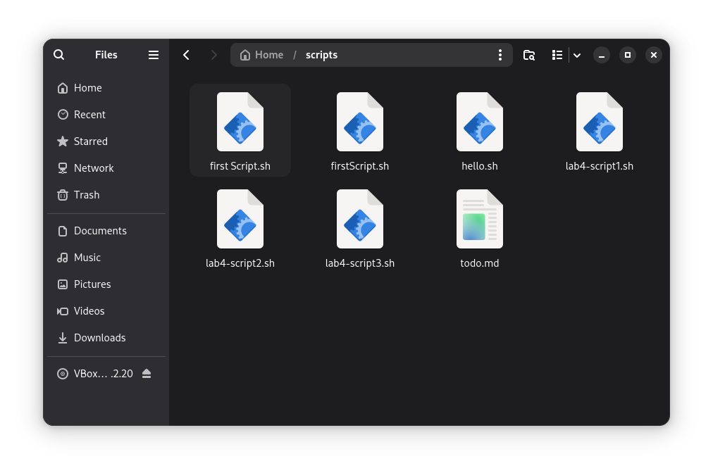
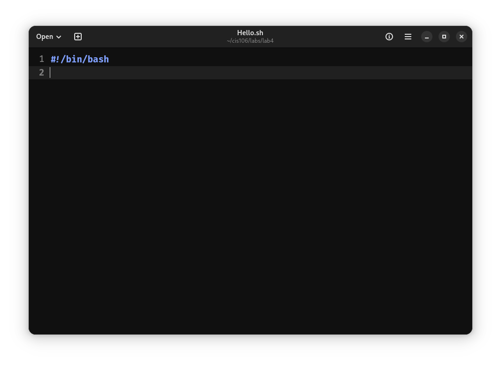
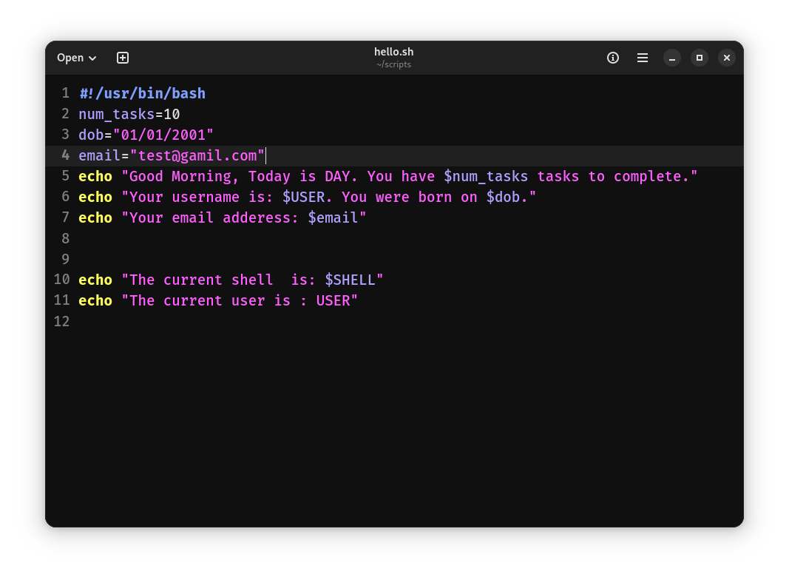
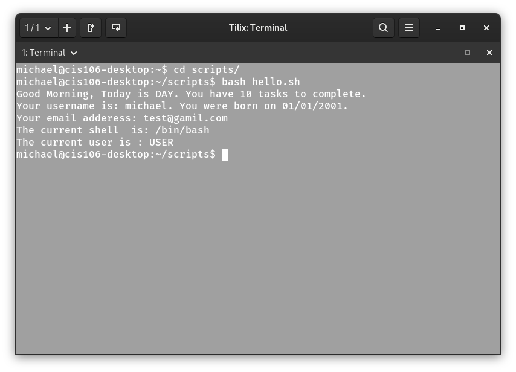

# Notes 4 

## **How to install and remove software using the APT command**

APT is a package manager used on Debian-based Linux Distributions, we use it instead os downloading installers from websites. The way APT works is that u ask for a package by name APT, it looks up the package in online repositories, works out which dependencies must also be installed then lastly it installs and configures everything automatically.Since we are making changes to the system we need to use put `sudo` in front of the commands we use.

### Command References

`sudo apt search (package name)` - searches for the package
`sudo apt show (package name)` - shows you details about he package
`sudo apt install (package name)` - APT lists the package it is about to install, and how much space it will use ,then asks for your confirmation to install.
Note: you can also instal several packages at once by just separating the names with spaces.EX:`sudo apt install (package name) (package name) (package name)`
`sudo apt remove (package name)` - removes a package but keeps its configuration files in etc.
`sudo apt purge (package name)` - removes the package along with its configuration files for a clean sweep.
`sudo apt autoremove` - cleans up the dependencies left behind by deleted packages.

## **How to create a shell script**

First off a shell script is a plain text file containing a list of commands. The shell reads the file and run the commands from top to bottom.

### Step 1 Create the file
- First off create a directory called 'scripts' this will be where you keep all your scripts.
- Next your going to need a text editor. 
- Now that u have your text editor, your going to create a **`.sh`** file (Ex: **`Hello.sh`**) now save that file in your scripts directory.
- 

### Step 2 Shell Declaration
- Now that u have created your script file go ahead and open it with your text editor.
- Once you have open your text editor open declare which shell will be executing the script.EX:**`#!/bin/bash` If you don't then the script will be useless as it doesn't have a shell to run on.
- 
- 
### Step 3 Write your code
- Here is the easy part, just write the your code/cmds in the script.
- Save it when done.
- 
  
### Step 4 Run script
- Lastly to run the script, go to your shell, navigate to your scripts directory `cd scripts/`.
- Once in your script directory you can run your script, to run it use the cmd:`bash Hello.sh` and viola your script should run.
- If your script hasn't ran then most likely it is name something else, go fix it and try again.
- 